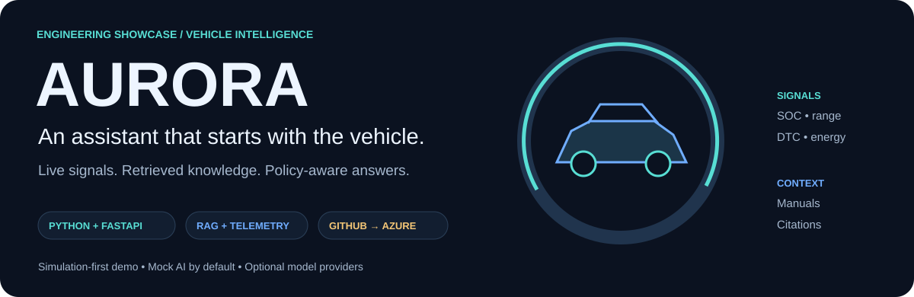
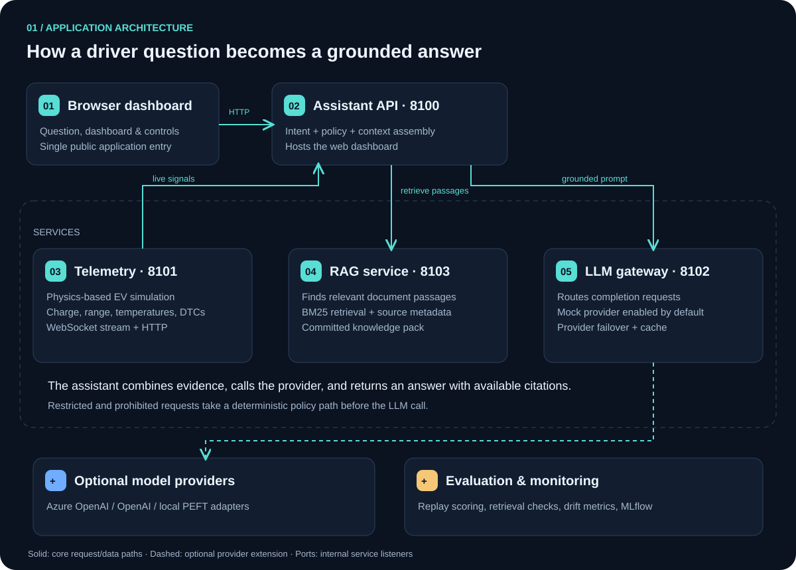
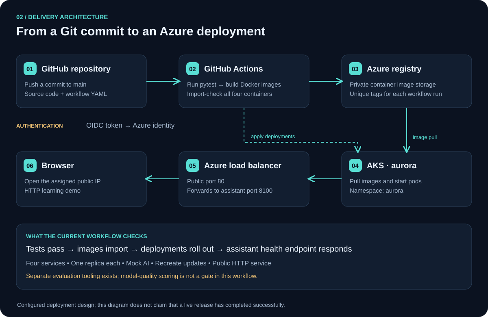

<div align="center">



[](https://github.com/Mohamed1-2/aurora/actions/workflows/aurora-azure.yml)


**A simulation-first vehicle assistant that connects live signals, retrieved knowledge, and a reproducible deployment pipeline.**

[Architecture](#architecture) · [Try it locally](#try-it-locally) · [Azure delivery](#from-github-to-azure) · [Engineering tour](#engineering-tour) · [Project scope](#project-scope)

</div>

## The idea in 30 seconds

A driver asks, **“Why is my range dropping?”** A useful answer needs more than a language model: it needs the vehicle's current state and relevant information about the vehicle.

AURORA brings those together. It reads simulated EV telemetry, retrieves relevant knowledge passages, applies a request policy, and builds a response from that context. The default **mock provider** generates deterministic responses without a model API key; external model providers are optional.

| Read the vehicle | Find the evidence | Explain the result |
| :--- | :--- | :--- |
| Charge, range, temperature, energy and diagnostic signals | BM25 retrieval over packaged knowledge, with support for a prepared manual corpus | Context-aware responses, available source citations and deterministic policy handling |

> **Project scope:** an engineering and learning demo, not a certified automotive system. The default stream is simulated. No real vehicle actuation or production safety certification is claimed.

## Architecture



### Follow one question

1. **Ask.** The browser sends a question to the assistant API.
2. **Classify.** The API identifies the intent and applies the request policy. Restricted and prohibited requests receive deterministic handling before a model call.
3. **Read.** The assistant gathers the recent telemetry window: the latest measurements and trends.
4. **Retrieve.** The RAG service finds relevant document passages. RAG means *retrieval-augmented generation*: give the responder evidence before asking it to answer.
5. **Respond.** The gateway invokes the configured provider. The mock provider is the default; configured model providers can use the same context.
6. **Return.** The API returns the answer and associated response metadata, including available citations.

### The services, in plain language

| Service | Responsibility | Port | Current Azure demo |
| :--- | :--- | :---: | :---: |
| **assistant-api** | Hosts the dashboard; coordinates policy, telemetry, retrieval and answers | `8100` | Deployed by workflow |
| **telemetry-simulator** | Produces simulated EV measurements and controllable scenarios | `8101` | Deployed by workflow |
| **rag-service** | Searches the knowledge pack and an optional prepared corpus | `8103` | Deployed by workflow |
| **llm-gateway** | Routes provider calls; implements caching and fallback behavior | `8102` | Deployed by workflow |
| **monitoring** | Exposes drift, service-health and AI-quality information | `8104` | Separate from demo workflow |
| **evaluation** | Runs offline scoring and model/retrieval comparisons | — | Separate tooling |

“Deployed by workflow” describes the configuration, not a confirmed live release. Use the Actions badge and rollout results to inspect the latest run.

## What you can explore

| Capability | Example | What powers it |
| :--- | :--- | :--- |
| Vehicle questions | “What is my current range and charge?” | Aggregated telemetry + grounded response |
| Diagnostics | “Do I have active trouble codes?” | DTC signals + retrieved explanations |
| Scenario testing | Change simulated charging or fault conditions | Simulator controls and scenario API |
| Dashboard / HUD | Inspect vehicle state as it changes | Browser interface + assistant API |
| Policy behavior | Ask to disable a safety system | Deterministic request classification and refusal |
| Prediction & explanation experiments | Inspect energy drivers and what-if behavior | Physics and optional calibration components |
| Model experiments | Compare baseline and LoRA-assisted responses | Separate training and evaluation tools |

Prediction, replay and model experiments have additional dependency or artifact requirements. Their presence in the repository does not mean the minimal Azure image includes everything needed to run them.

## Try it locally

Use **Python 3.11**. These commands start the services on your machine and use the mock provider, so no AI API key is required.

```bash
git clone https://github.com/Mohamed1-2/aurora.git
cd aurora
python3.11 -m venv .venv
source .venv/bin/activate

python -m pip install --upgrade pip
python -m pip install 'uvicorn[standard]' fastapi 'pydantic>=2' \
  pydantic-settings numpy prometheus-client httpx websockets pyyaml
python -m pip install -e shared
python -m pip install -r requirements-dev.txt

export AURORA_GATEWAY_PROVIDER_PRIORITY=mock
export AURORA_RAG_KB_DIR="$PWD/services/rag-service/knowledge_base"
make services
```

Open **[localhost:8100](http://localhost:8100)** for the dashboard. On Windows, use WSL for the shell and Make commands above.

Test a request:

```bash
curl --fail-with-body http://localhost:8100/v1/ask \
  -H 'Content-Type: application/json' \
  --data '{"question":"What is my current range and state of charge?"}'
```

The numeric answer changes with the simulator state. The mock provider is deterministic for a given context; it is not a locally running generative model.

<details>
<summary><strong>Useful local commands</strong></summary>

```bash
# Run the Python tests in the active environment.
python -m pytest -q

# Inspect the assistant log.
tail -f /tmp/aurora-assistant.log

# Stop this development stack.
make stop
```

`make stop` uses a process-name match for `uvicorn app.main`; it can also stop other local processes with that command. Use it in a dedicated development session.

The repository also contains Docker Compose configuration. The Azure workflow generates adjusted Dockerfiles that preserve the directory structure used by runtime imports; do not assume those generated images and the original Compose builds are identical.

</details>

## From GitHub to Azure



The active workflow is **[AURORA Azure](.github/workflows/aurora-azure.yml)**. It runs on pushes to `main` and supports manual execution.

| Stage | What happens | Why it matters |
| :--- | :--- | :--- |
| **Test** | Run pytest | Catch regressions before deployment |
| **Prepare** | Generate demo Dockerfiles and Kubernetes YAML | Keep the demo configuration explicit |
| **Authenticate** | Exchange a GitHub OIDC token for Azure credentials | Avoid a stored, long-lived Azure password |
| **Build & check** | Build four Linux images and import each application | Catch packaging and startup-import failures |
| **Publish** | Push uniquely tagged images to private ACR | Associate each image with a commit and workflow run |
| **Deploy** | Apply manifests and wait for deployment rollouts | Confirm pods reach the expected ready state |
| **Health check** | Call the assistant health endpoint inside its pod | Confirm the process answers a basic health request |

**A health check is not an end-to-end quality evaluation.** Retrieval, grounded-answer quality, browser behavior and model experiments require their own checks. The current workflow does not run the separate golden-set evaluation gate.

### One-time setup vs. every release

**Once:** create or select the AKS cluster; run [setup-azure.sh](scripts/azure-demo/setup-azure.sh) to configure ACR, GitHub federation, role assignments, a namespace and repository variables. Review its repository/branch and subscription settings before running it for another account.

**Every release:** push to `main`; GitHub's runner builds and publishes images, then updates AKS. Docker runs on the runner, so a developer does not need to keep their laptop online after the push.

<details>
<summary><strong>Inspect a deployment from your terminal</strong></summary>

Prerequisites: authenticated `az` and `gh`, plus `kubectl` and Azure `kubelogin`.

```bash
# Inspect recent pipeline runs.
gh run list --repo Mohamed1-2/aurora --workflow aurora-azure.yml --limit 5

# Connect to the configured demo cluster.
az aks get-credentials --resource-group aurora-rg --name aurora
kubelogin convert-kubeconfig -l azurecli

# Inspect desired replicas, running pods and network services.
kubectl get deployments,pods,services -n aurora

# Read recent application logs.
kubectl logs -n aurora deployment/assistant-api --tail=100

# Find the demo's public IP. Open http://EXTERNAL-IP when assigned.
kubectl get service aurora-web -n aurora
```

A failed test blocks the deploy job. `ImagePullBackOff` points toward image or registry access problems; `CrashLoopBackOff` calls for application logs; `Pending` requires inspecting scheduling events.

</details>

### Cost and deployment boundaries

The generated demo runs **one replica per core service**, uses the **mock provider**, disables proactive polling, and uses **Recreate** updates. Recreate stops the old pod before replacing it, so releases can interrupt service.

AKS nodes, registry storage and networking are billable resources. “Free” AKS cluster management does not make those resources free. Stopping the cluster reduces compute use, but retained resources may still cost money.

The demo exposes **HTTP**, not configured HTTPS. TLS, user authentication, rate limits, durable application state and recovery procedures are next steps before a production release. Some debug UI calls still target localhost; operations endpoints deliberately restrict access to local clients.

## Quality, policy and model experiments

### Policy before generation

| Request class | Behavior |
| :--- | :--- |
| Read-only | Build a response from vehicle and document context |
| Safe action | Follow the implemented application policy |
| Restricted action | Return deterministic confirmation-required handling |
| Prohibited action | Refuse without consulting the language model |

These are application controls and testable behaviors—not proof of automotive safety or authorization to control a real vehicle.

### Reproducible experiments

- **Replay:** fixed telemetry snapshots make repeatable answer comparisons possible.
- **Retrieval:** BM25 indexing and retrieval tests make document selection inspectable.
- **Evaluation:** golden-set scoring covers signal accuracy, grounding, refusal and policy behavior.
- **Fine-tuning:** separate simulation and real PEFT/LoRA paths distinguish pipeline exercises from actual model training.
- **Monitoring:** separate drift and quality tooling helps inspect changes over time.

The data pipelines support TUM driving telemetry and EPFL charging sessions as separate domains. Review source licenses and provenance before redistribution; real telemetry inputs do not make synthetically generated question–answer pairs human-labelled ground truth.

## Engineering tour

For a technical walkthrough or interview, explain the system in this order:

1. **Problem:** a vehicle assistant needs current measurements and relevant knowledge.
2. **Design:** separate telemetry, retrieval and provider routing behind one assistant API.
3. **Packaging:** Docker images capture application code and runtime dependencies.
4. **Delivery:** GitHub Actions tests, builds, publishes and deploys to AKS.
5. **Identity:** OIDC establishes who the workflow is; role assignments determine what it can do.
6. **Evidence:** show a real workflow run, pod status, logs and an actual API response.
7. **Tradeoffs:** one-node learning environment, process-local state, mock AI and incomplete production hardening.

| Common term | Plain-language meaning |
| :--- | :--- |
| Container image | Packaged application and its dependencies |
| Container | A running instance of an image |
| Registry | A store for built images |
| Pod | Kubernetes' smallest deployable unit |
| Deployment | Desired application image and replica count |
| Service | Stable networking for a set of pods |
| CI / CD | Automated checks / automated delivery or deployment |
| OIDC | A way to establish identity using signed tokens |
| RAG | Retrieve relevant evidence before generating an answer |

## Explore the repository

```text
.github/workflows/aurora-azure.yml   Active Azure delivery workflow
scripts/azure-demo/                 Azure setup + demo manifest generator
services/assistant-api/             Dashboard, policy, context and API
services/telemetry-simulator/       EV simulation and scenario engine
services/rag-service/               Retrieval and packaged knowledge
services/llm-gateway/               Provider routing and completions
services/calibration/               Prediction/calibration experiments
services/evaluation/                Datasets, scoring and comparisons
services/monitoring/                Drift and quality monitoring
shared/vehicle_ai/                 Shared schemas and utilities
infra/k8s/                         Kubernetes configuration
infra/terraform/                   Separate infrastructure provisioning path
tests/                             Python test suite
```

## Go deeper

| Guide | What you will learn |
| :--- | :--- |
| [Architecture](docs/architecture.md) | Telemetry, grounding, service contracts and scoring |
| [Interactive demo](docs/interactive-demo.md) | Application walkthrough and controls |
| [Dataset design](docs/dataset.md) | Data generation, provenance and split strategy |
| [Fine-tuning](docs/finetuning.md) | Simulation vs. real training and comparisons |
| [Operations showcase](docs/operations-showcase.md) | Local trace and release-management experiments |
| [Azure workflow](.github/workflows/aurora-azure.yml) | The exact automated delivery steps |

For deployment behavior, the active workflow and `scripts/azure-demo/prepare.py` are the source of truth. Older infrastructure examples may use different names, replica counts or release gates.

---

<div align="center">

**Understand the vehicle. Retrieve the evidence. Make the system inspectable.**

AURORA · Python microservices · Retrieval · Simulation · Azure delivery

</div>
