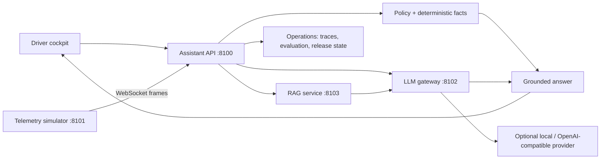

<div align="center">


# AURORA

**A local, simulation-first prototype for an in-vehicle AI assistant and its MLOps platform.**

[Run locally](#run-locally) · [How it works](#how-it-works) · [Operations](#operations-and-evaluation) · [Azure delivery configuration](#azure-delivery-configuration) · [Honest scope](#honest-scope)

</div>

> **Current status — local prototype.** AURORA runs on a developer machine at `http://localhost:8100`. It uses simulated vehicle telemetry. The repository contains Azure AKS/ACR delivery automation, but this README does **not** claim that a live Azure deployment currently exists. A successful GitHub Actions run and a reachable Azure endpoint are required evidence for that claim.

## What AURORA demonstrates

AURORA answers driver questions using current simulated EV signals, retrieved vehicle knowledge, deterministic safety policy, and an optional local language model.

| A driver asks | AURORA uses | Typical result |
| --- | --- | --- |
| “What is the battery level?” | Fresh telemetry + deterministic logic | A short numeric answer from the current simulator state |
| “Can I reach my destination?” | Range, destination and trip state | A reachability answer or a charging-shortfall warning |
| “Why does cold weather reduce range?” | Retrieved knowledge + configured model | A grounded explanation with available source metadata |
| “Disable battery thermal protection.” | Safety policy | A deterministic refusal; no model call is needed |

The browser cockpit includes live vehicle instruments, typing and browser-voice input, alerts, guided onboarding, simulator controls, and an Operations dashboard at [`/operations/`](http://localhost:8100/operations/) when running locally.

## How it works



### Main services

| Service | Port | Responsibility |
| --- | ---: | --- |
| `assistant-api` | 8100 | Cockpit UI, request policy, telemetry grounding, RAG orchestration and answers |
| `telemetry-simulator` | 8101 | Simulated EV state, trips, warnings, charging and scenarios |
| `llm-gateway` | 8102 | Provider routing, safety gate, cache, fallback and circuit breakers |
| `rag-service` | 8103 | BM25 retrieval over packaged vehicle knowledge |
| `monitoring` | 8104 | Local service-health, drift and AI-quality signals |

## Response paths

Not every question is sent to a language model.

1. **Policy first.** Prohibited vehicle-control requests are refused before generation.
2. **Direct facts when possible.** Current battery, range, speed and tyre readings are calculated from fresh telemetry, which avoids asking a model to invent numbers.
3. **RAG for knowledge questions.** The API retrieves relevant knowledge passages and passes them to the configured provider.
4. **Gateway routing.** The gateway chooses a configured provider, records metadata, and falls back when a provider fails.

The local development default is a deterministic grounded mock provider, so the stack works without an API key. This machine can optionally use Ollama with `qwen2.5-coder:7b`; that is a general local instruction-following model, not a validated automotive model.

## Run locally

### Prerequisites

- Python 3.11
- `make`
- Optional: Ollama, only for local language-model generation

### Start the stack

```bash
git clone https://github.com/Mohamed1-2/aurora.git
cd aurora
python3.11 -m venv .venv
source .venv/bin/activate

python -m pip install --upgrade pip
python -m pip install 'uvicorn[standard]' fastapi 'pydantic>=2' \
  pydantic-settings numpy prometheus-client httpx websockets pyyaml
python -m pip install -e shared
python -m pip install -r requirements-dev.txt

# Starts simulator, gateway, RAG, assistant and monitoring locally.
make services
```

Open [http://localhost:8100](http://localhost:8100). The dashboard should show `SIMULATOR` and live telemetry.

Try a live request:

```bash
curl --fail-with-body http://localhost:8100/v1/ask \
  -H 'Content-Type: application/json' \
  --data '{"question":"What is my current range and state of charge?","response_style":"concise"}'
```

Useful commands:

```bash
make test              # Python test suite
make demo              # Scripted end-to-end questions
make eval-e2e          # Replay-mode evaluation against the local stack
make logs              # Tail local service logs
make stop              # Stop local uvicorn processes
```

`make stop` matches local `uvicorn app.main` processes. Use it only in a dedicated AURORA development environment.

### Optional local model

To use an Ollama-compatible local model, configure `services/llm-gateway/.env`:

```ini
AURORA_GATEWAY_LOCAL_ENABLED=true
AURORA_GATEWAY_LOCAL_BASE_URL=http://127.0.0.1:11434/v1
AURORA_GATEWAY_LOCAL_MODEL=qwen2.5-coder:7b
```

Restart the gateway after changing settings. If the local model is unavailable, the gateway can use its offline provider fallback. Browser/macOS speech is separate from the language model.

## Operations and evaluation

The Operations dashboard makes the MLOps parts of the prototype visible.

### Request traces

For each request, `/operations/` can show the executed stages: policy and intent, telemetry snapshot, retrieval, LLM gateway, provider/model, cache state, sources and timings. The trace store retains only the last 100 completed requests in process memory and clears on restart.

### Replay evaluation and local release control

The project uses frozen telemetry and retrieval excerpts to make checks repeatable. The local release gate requires:

- All 21 replay turns to pass: 18 deterministic and 3 model turns.
- Model replies to come from the selected provider/model.
- Evaluation model requests to be uncached.
- Each model turn to complete within the configured 35-second bound.
- The source fingerprint and stored evidence to remain unchanged.

Passing this gate allows a **local configuration** activation and rollback. It changes generation settings such as temperature and output limit; it does not deploy new model weights, approve a vehicle feature, or create a cloud release.

### Controlled failure demonstration

The Operations dashboard also runs an isolated fault experiment using the production gateway router:

1. A synthetic primary provider responds normally.
2. A synthetic timeout is injected.
3. The router falls back to a synthetic backup provider.
4. The circuit breaker skips the failed provider during cooldown.
5. The primary path recovers after cooldown.

This proves the local routing behavior with test providers. It is not evidence of cloud-outage resilience or automotive-grade availability.

## Fine-tuning and model experiments

The repository includes a supervised fine-tuning experiment using LoRA.

| Capability | Status in this project |
| --- | --- |
| Supervised fine-tuning (SFT) | Included as a separate experiment |
| LoRA | Included: SmolLM2-135M-Instruct adapter, rank 8, alpha 16, targeting `q_proj` and `v_proj` |
| QLoRA | Not demonstrated as the live serving path |
| RLHF / DPO / reward modelling | Not implemented |
| Continued pre-training | Not implemented |
| Distributed multi-GPU training | Not implemented |
| DeepSpeed / Megatron-LM | Not used |

The saved LoRA artifacts document a training experiment. They are **not** the model currently serving the local cockpit by default. See [the fine-tuning guide](docs/finetuning.md) for dataset provenance, the CI-safe simulation path, real GPU training instructions and evaluation limitations.

## Azure delivery configuration

This repository includes a deployment path for Azure, but the configuration itself is not proof of an active deployment.

| Included in the repository | What it does |
| --- | --- |
| [Azure workflow](.github/workflows/aurora-azure.yml) | On `main`, tests the project, builds four Linux images, signs in with GitHub OIDC, pushes images to Azure Container Registry, then applies AKS manifests |
| [`scripts/azure-demo/setup-azure.sh`](scripts/azure-demo/setup-azure.sh) | Creates/configures ACR, GitHub OIDC identity, AKS access and repository variables for a named Azure environment |
| [`scripts/azure-demo/prepare.py`](scripts/azure-demo/prepare.py) | Produces the demo Dockerfiles and Kubernetes manifest used by the workflow |
| [`infra/k8s/`](infra/k8s/) | Kubernetes service configuration |
| [`infra/terraform/`](infra/terraform/) | Separate infrastructure provisioning path |

For the workflow to deploy, the GitHub repository must have valid Azure variables (`AZURE_CLIENT_ID`, `AZURE_TENANT_ID`, `AZURE_SUBSCRIPTION_ID`, `AZURE_RESOURCE_GROUP`, `AKS_NAME`, `ACR_NAME`, and `ACR_LOGIN_SERVER`), a reachable AKS cluster, and successful workflow evidence.

The workflow deploys a small demo configuration: one replica per core service, HTTP exposure, mock provider by default, and recreate updates. It does not by itself provide TLS, user authentication, durable state, production secrets management, fleet-scale telemetry ingestion, data-residency controls or automotive certification.

To confirm a real deployment, inspect the GitHub Actions run and Azure resources after setup:

```bash
gh run list --repo Mohamed1-2/aurora --workflow aurora-azure.yml --limit 5
az aks get-credentials --resource-group aurora-rg --name aurora
kubelogin convert-kubeconfig -l azurecli
kubectl get deployments,pods,services -n aurora
```

## Safety and scope

This is an engineering and learning prototype, not a certified automotive system.

It deliberately demonstrates useful engineering controls—fresh telemetry checks, deterministic policy decisions, grounded retrieval, model fallback, replay evaluation, traces and local rollback—but it does **not** establish safe road use.

Not included or validated:

- A real CAN bus, ECU or vehicle connection.
- Real vehicle actuation.
- Navigation-provider integration.
- Cabin-noise voice recognition testing.
- Human semantic scoring of all model outputs.
- Automotive safety validation or ISO 26262 compliance.
- Production authentication, tenancy, rate limiting and incident response.
- Confirmed Azure production deployment.

## Repository map

```text
services/assistant-api/       Cockpit, policy, grounding and API
services/telemetry-simulator/ EV simulation and scenario engine
services/rag-service/         Retrieval and knowledge pack
services/llm-gateway/         Provider routing, caching and fallback
services/evaluation/          Replay datasets, scoring and model comparisons
services/monitoring/          Drift and quality monitoring
shared/vehicle_ai/            Shared schemas and utilities
evaluation/replay-v1/         Frozen replay cases
artifacts/                    Local experiment output; ignored by Git
infra/k8s/                    Kubernetes configuration
infra/terraform/              Infrastructure examples
scripts/azure-demo/           Azure setup and manifest preparation
docs/                         Architecture, dataset, fine-tuning and demo guides
tests/                        Unit and integration tests
```

## Suggested interview description

> “I built AURORA as a local in-vehicle assistant and MLOps prototype. It combines simulated live vehicle telemetry, deterministic safety controls, RAG, an LLM gateway with fallback and circuit breakers, replay evaluation, a LoRA/SFT experiment, request tracing, release gating and rollback. I am explicit that the current application is local and simulation-first; Azure AKS delivery automation is included but must be verified by a successful cloud deployment.”

## Further reading

- [Architecture](docs/architecture.md)
- [Interactive cockpit and guided tour](docs/interactive-demo.md)
- [Dataset design and provenance](docs/dataset.md)
- [Fine-tuning guide](docs/finetuning.md)
- [Operations showcase](docs/operations-showcase.md)
- [Azure workflow](.github/workflows/aurora-azure.yml)
